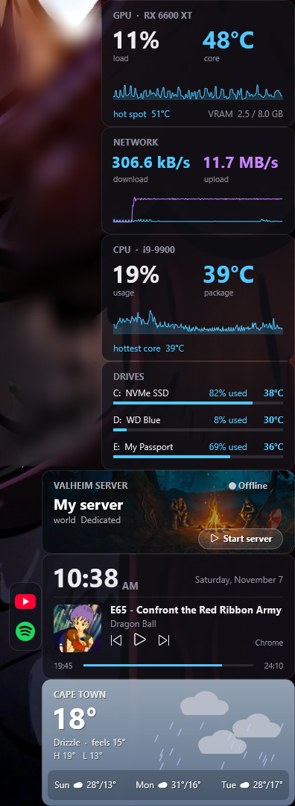
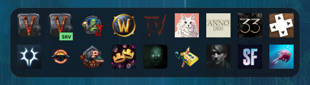
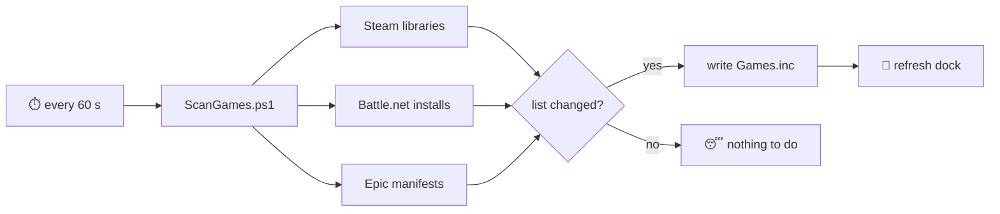

<p align="center">
  
</p>

<p align="center">
  
  
  
  
  <br>
  <a href="https://github.com/Kayla-LeeJ/my_widgets/actions/workflows/checks.yml"></a>
  <a href="https://github.com/Kayla-LeeJ/my_widgets/releases/latest"></a>
</p>

<p align="center"><b>A matching set of glassy Rainmeter widgets that make your desktop feel alive</b><br>
hardware stats 🌡️ · a weather sky that follows the real sun 🌅 · now playing 🎵 · a game launcher that finds your games by itself 🎮</p>

---

## 📸 The real thing

<p align="center">
  
  &nbsp;&nbsp;&nbsp;
  
</p>

---

## ✨ What's in the box

| | Widget | What it does |
|---|---|---|
| 🧠 | **CPU** | Usage, package temperature and your hottest core, turning cool blue → warm orange → hot red |
| 🎨 | **GPU** | Load, core and hot-spot temperature, and VRAM use |
| 💾 | **Drives** | Temperature and how full each drive is |
| 🌐 | **Network** | Live download and upload speed (no extra software needed) |
| 🌦️ | **Weather** | Current weather and a 3-day forecast over a *living sky*: real sunrise and sunset, stars and the actual moon phase at night, clouds, rain and snow to match |
| 🎵 | **Now Playing** | Clock, date, and whatever's playing in Windows' media controls (Spotify, YouTube in the browser, Media Player…), with play/pause/skip |
| 🔗 | **Links** | A tiny YouTube + Spotify strip that sits beside Now Playing |
| ⚔️ | **Valheim** | Your Valheim dedicated server: online/offline, players, and the crossplay join code (click to copy!) |
| 🎮 | **Game Dock** | Every installed game from **Steam**, **Battle.net** and **Epic**, found automatically. Install something new and its icon pops up within a minute. A little dot shows what's running |

> [!TIP]
> **Right-click any widget → Theme** to repaint the whole desktop in one click: 🌌 Midnight · 🌸 Sakura · 🌲 Forest · 🌊 Ocean · ⚫ Mono

> [!NOTE]
> Every widget reads its settings from one file: [`SystemMonitor/@Resources/Variables.inc`](SystemMonitor/@Resources/Variables.inc). Colours, thresholds, your city, which drives to show… it's all in there.

---

## 🧰 Prerequisites

| Need it? | What | Why |
|---|---|---|
| ✅ Required | **Windows 10 or 11** | Rainmeter is Windows-only |
| ✅ Required | **[Rainmeter 4.5+](https://www.rainmeter.net/)** | Draws the widgets |
| ✅ Required | **Windows PowerShell 5.1** | Already built into Windows; runs the helper scripts |
| 🌡️ For CPU / GPU / Drives | **[LibreHardwareMonitor](https://github.com/LibreHardwareMonitor/LibreHardwareMonitor/releases)** | Reads temperatures and loads |
| 🎮 Optional | Steam, Battle.net and/or Epic Games Launcher | Whatever you have shows up in the Game Dock |
| ⚔️ Optional | Valheim Dedicated Server (Steam) | For the Valheim card |
| 🧪 Optional | Thunderstore Mod Manager | For the dock's *modded* Valheim button |

The Weather card uses [open-meteo.com](https://open-meteo.com/), which is free and needs **no API key**. 🎉

---

## 🚀 Installation

### Option A: the one-click way 🪄
1. Install [Rainmeter](https://www.rainmeter.net/).
2. Grab the latest **`my_widgets_x.y.z.rmskin`** from [Releases](https://github.com/Kayla-LeeJ/my_widgets/releases/latest).
3. Double-click it → **Install**. Done! The Weather card loads straight away. Load the rest from **Manage** (step 5 below).

Updating later? Just install the newer `.rmskin`. Your settings in `Variables.inc` are kept. ✨

### Option B: the developer way 🛠️

```bash
git clone https://github.com/Kayla-LeeJ/my_widgets.git
```

Then link the repo into Rainmeter's skins folder, so `git pull` updates your desktop and your edits are ready to commit. Run this in PowerShell from inside the cloned repo:

```powershell
New-Item -ItemType Junction -Path "$([Environment]::GetFolderPath('MyDocuments'))\Rainmeter\Skins\SystemMonitor" -Target "$PWD\SystemMonitor"
```

<details>
<summary>Rather copy than link?</summary>

Copy the `SystemMonitor` folder into `Documents\Rainmeter\Skins`. You'll need to copy again after each `git pull`.
</details>

---

## 🔧 Setup

### 1. Turn on LibreHardwareMonitor (for the CPU, GPU and Drives cards)
1. Run **LibreHardwareMonitor** as administrator.
2. Turn on **Options → Remote Web Server → Run**. The default port `8085` is what the widgets expect.
3. Tick **Options → Run On Windows Startup** and **Start Minimized** so it's always there.

### 2. Run the setup wizard 🧙
From the repo folder:

```powershell
powershell -ExecutionPolicy Bypass -File .\Setup.ps1
```

It finds your CPU, GPU and drive sensors, matches drives to their letters, asks for your city and looks up its coordinates (free, no API key), then saves everything to `Variables.inc` and refreshes Rainmeter. Add `-WhatIf` to preview the changes first, or `-City "Tokyo" -Units fahrenheit` to skip the question.

<details>
<summary>Doing it by hand instead</summary>

Open <http://localhost:8085>, find your sensor IDs (like `/intelcpu/0/temperature/10`) and paste them into the **Sensors** section of `SystemMonitor/@Resources/Variables.inc`. Set `WeatherCity`, `WeatherLat` and `WeatherLon` in the **Weather** section.
</details>

### 3. Make it yours
In `SystemMonitor/@Resources/Variables.inc`:
- 🎨 `Theme`: `Midnight`, `Sakura`, `Forest`, `Ocean` or `Mono` (or right-click any widget)
- 🎮 `DockColumns`: icons per row in the Game Dock
- 🙈 `DockHide`: games to keep off the dock, e.g. `Outlast,Wallpaper Engine`
- 🌡️ The **Thresholds** section: when temperatures turn warm and hot

### 4. Load them
Right-click the Rainmeter icon in the tray → **Manage** → open **SystemMonitor**, then pick each widget and hit **Load**. Drag them around until it looks right. 🖱️

---

## 🎮 How the Game Dock finds your games



- Icons come from Steam's CDN in HD, or straight out of the game's `.exe`, and are saved in `@Resources/Icons/auto` (not committed, every PC makes its own).
- Want a custom icon or launch button for one game? Add it to the `$custom` table at the top of [`ScanGames.ps1`](SystemMonitor/@Resources/ScanGames.ps1). That's how modded Valheim and the **SRV** badge work.

---

## 🎨 Make your own theme

Copy any file in [`SystemMonitor/@Resources/Themes`](SystemMonitor/@Resources/Themes), rename it (say `Lavender.inc`), change the colours (`R,G,B` or `R,G,B,alpha`), then set `Theme=Lavender` in `Variables.inc`. To get it in the right-click menu too, add a line for it next to the others in `Common.inc`, `Dock.ini` and `Links.ini`.

---

## 🗂️ What's where

```text
my_widgets/
├── Setup.ps1                🧙 setup wizard
├── tools/Build-Rmskin.ps1   📦 builds the one-click installer
├── .github/workflows/       🤖 checks on every push, releases on every tag
└── SystemMonitor/           the skin itself
    └── @Resources/
        ├── Variables.inc    ← ⭐ all your settings
        └── Themes/          🎨 colour themes
```

```text
SystemMonitor/
├── @Resources/
│   ├── Variables.inc        ← ⭐ all your settings
│   ├── Common.inc, Helper.inc, LHM.inc   shared bits the widgets include
│   ├── DeskHelper.ps1       background helper: now playing + Valheim server status
│   ├── ScanGames.ps1        finds installed games for the dock
│   ├── StartValheim.ps1     starts modded Valheim via your Thunderstore profile
│   ├── StopValheimServer.ps1  stops the server safely (saves the world first)
│   ├── Weather.lua, Helpers.lua
│   └── Icons/, Images/
├── CPU/  GPU/  Drives/  Network/
├── Weather/  NowPlaying/  Links/
├── Valheim/
└── Dock/
```

---

## 🩹 Troubleshooting

<details>
<summary>🌡️ CPU / GPU / Drives show nothing</summary>

LibreHardwareMonitor isn't running, or its web server is off. Open <http://localhost:8085>. If that page doesn't load, the widgets can't read it either. If it loads, check the sensor IDs in `Variables.inc` match yours.
</details>

<details>
<summary>🎵 Now Playing is stuck</summary>

It talks to `DeskHelper.ps1` on port `8086`. Refresh the Now Playing skin to restart it, and make sure nothing else is using that port.
</details>

<details>
<summary>⚔️ Valheim card never shows players or a join code</summary>

The server has to write a log. Add `-logFile` to the server's `start_headless_server.bat`.
</details>

<details>
<summary>🎮 A game is missing from the dock (or one shouldn't be there)</summary>

Wait a minute, since the dock checks every 60 seconds. Steam games only appear once fully downloaded. To hide something, add its name or Steam app ID to `DockHide` in `Variables.inc`.
</details>

---

## 📦 Releasing a new version

```bash
git tag v1.1.0
```

```bash
git push origin v1.1.0
```

GitHub builds `my_widgets_1.1.0.rmskin` and publishes it on the [Releases](https://github.com/Kayla-LeeJ/my_widgets/releases) page. 🚀 To build one locally instead: `.\tools\Build-Rmskin.ps1 -Version 1.1.0` (it lands in `dist\`).

---

<p align="center">Made with 💜, too much coffee, and a desktop that refuses to be boring.</p>
