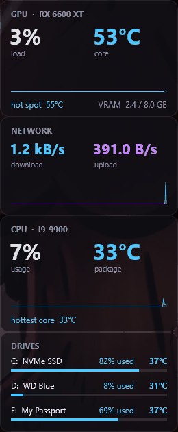
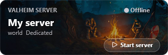
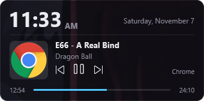
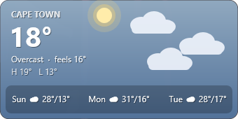
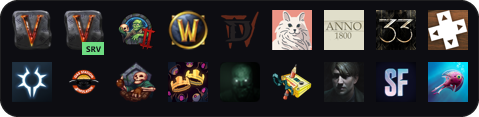

<p align="center">
  
</p>

<p align="center">
  <a href="https://github.com/Kayla-LeeJ/my_widgets/actions/workflows/checks.yml"></a>
  <a href="https://github.com/Kayla-LeeJ/my_widgets/releases/latest"></a>
  <a href="LICENSE"></a>
  
  
</p>

A set of [Rainmeter](https://www.rainmeter.net/) widgets for Windows: hardware monitoring, weather, now playing, a Valheim server card and a game launcher that finds installed games on its own. All cards share one look and one settings file.

## Screenshots

<table align="center">
  <tr>
    <td rowspan="3" valign="top"></td>
    <td></td>
  </tr>
  <tr>
    <td></td>
  </tr>
  <tr>
    <td></td>
  </tr>
  <tr>
    <td colspan="2" align="center"></td>
  </tr>
</table>

## Widgets

| Widget | Shows |
|---|---|
| **CPU** | Usage, package temperature, hottest core. Values turn amber and red past configurable thresholds. |
| **GPU** | Load, core and hot-spot temperature, VRAM use. |
| **Drives** | Temperature and used space for up to three drives. |
| **Network** | Download and upload speed on the active adapter. |
| **Weather** | Current conditions and a 3-day forecast from open-meteo.com. The background follows the actual sunrise, sunset, moon phase and weather. |
| **Now Playing** | Clock, date, and the track in Windows' media controls (Spotify, browsers, Media Player), with play/pause/skip. |
| **Links** | YouTube and Spotify shortcuts next to Now Playing. |
| **Valheim** | Status of a local Valheim dedicated server: online/offline, players, crossplay join code (click to copy). Start and stop buttons. |
| **Game Dock** | Every installed Steam, Battle.net and Epic game, rescanned every minute. A dot marks games that are running. |

Right-click any widget and choose **Theme** to switch all of them between Midnight, Sakura, Forest, Ocean and Mono.

## Requirements

| | |
|---|---|
| Windows 10 or 11 | |
| [Rainmeter](https://www.rainmeter.net/) 4.5 or later | |
| Windows PowerShell 5.1 | Included with Windows |
| [LibreHardwareMonitor](https://github.com/LibreHardwareMonitor/LibreHardwareMonitor/releases) | For the CPU, GPU and Drives cards |
| Steam, Battle.net, Epic Games Launcher | Optional, for the Game Dock |
| Valheim Dedicated Server (Steam) | Optional, for the Valheim card |
| Thunderstore Mod Manager | Optional, for the dock's modded Valheim launcher |

The weather data needs no API key.

## Install

### From a release

1. Install Rainmeter.
2. Download the latest `my_widgets_x.y.z.rmskin` from [Releases](https://github.com/Kayla-LeeJ/my_widgets/releases/latest) and open it.
3. Click **Install**. The Weather card loads automatically; load the others from **Manage** (see [Load the widgets](#load-the-widgets)).

Installing a newer `.rmskin` later keeps your `MyVariables.inc`.

### From source

```bash
git clone https://github.com/Kayla-LeeJ/my_widgets.git
```

Link the skin into Rainmeter's skins folder so the repo and your desktop stay the same files. In PowerShell, from the repo folder:

```powershell
New-Item -ItemType Junction -Path "$([Environment]::GetFolderPath('MyDocuments'))\Rainmeter\Skins\SystemMonitor" -Target "$PWD\SystemMonitor"
```

Copying the `SystemMonitor` folder into `Documents\Rainmeter\Skins` also works, but then needs repeating after each `git pull`.

## Setup

### LibreHardwareMonitor

1. Run LibreHardwareMonitor as administrator.
2. Enable **Options > Remote Web Server > Run** (port `8085`).
3. Enable **Options > Run On Windows Startup** and **Start Minimized**.

### Settings

Defaults live in `SystemMonitor/@Resources/Variables.inc`. Your own values go in `MyVariables.inc` in the same folder, which overrides the defaults and is ignored by git, so your location and hardware stay out of the repo.

The setup script fills it in:

```powershell
powershell -ExecutionPolicy Bypass -File .\Setup.ps1
```

It reads your CPU, GPU and drive sensor IDs from LibreHardwareMonitor, matches drives to their letters, looks up coordinates for a city you enter, saves everything to `MyVariables.inc` and refreshes Rainmeter.

| Option | |
|---|---|
| `-WhatIf` | Show the changes without saving |
| `-City "Tokyo"` | Skip the city prompt |
| `-Units fahrenheit` | Temperature units for the weather card |

Other settings you may want to override in `MyVariables.inc` (under a `[Variables]` line):

| Setting | Default | |
|---|---|---|
| `Theme` | `Midnight` | Also set by the right-click menu |
| `DockColumns` | `9` | Game Dock icons per row |
| `DockHide` | *(empty)* | Games to leave out, by name or Steam app ID: `Outlast,Wallpaper Engine` |
| `CpuWarm`, `CpuHot`, ... | | Temperature thresholds, see the Thresholds section of `Variables.inc` |

### Load the widgets

Right-click the Rainmeter tray icon, open **Manage**, expand **SystemMonitor**, and load each widget. Drag them into place.

## Game Dock

`ScanGames.ps1` runs every 60 seconds. It reads Steam's library manifests, Battle.net's uninstall entries and Epic's install manifests, and rewrites `Dock/Games.inc` only when the list of games changes. Icons come from Steam's CDN or from the game's executable and are cached in `@Resources/Icons/auto`. Both are generated per PC and not committed.

To give a game a custom icon, launch command or badge, add it to the `$custom` table at the top of [`ScanGames.ps1`](SystemMonitor/@Resources/ScanGames.ps1).

## Themes

Themes are files in [`SystemMonitor/@Resources/Themes`](SystemMonitor/@Resources/Themes) that set ten colour variables. To add one, copy an existing file, change the colours (`R,G,B` or `R,G,B,alpha`) and set `Theme=YourTheme` in `MyVariables.inc`. To list it in the right-click menu, add a `ContextTitle`/`ContextAction` pair in `Common.inc`, `Dock/Dock.ini` and `Links/Links.ini`.

## Repository layout

```text
Setup.ps1                     setup script
tools/Build-Rmskin.ps1        builds the .rmskin installer
tools/RMSKIN.bmp              installer header image
.github/workflows/            checks on push, release on tag, Claude GitHub App
docs/                         banner and screenshots
SystemMonitor/                the Rainmeter skin
├── @Resources/
│   ├── Variables.inc         defaults
│   ├── MyVariables.inc       your settings (not committed)
│   ├── Themes/               colour themes
│   ├── Common.inc, Helper.inc, LHM.inc
│   ├── DeskHelper.ps1        local helper for Now Playing and the Valheim card (port 8086)
│   ├── ScanGames.ps1         game detection for the dock
│   ├── StartValheim.ps1      starts Valheim with a Thunderstore profile
│   ├── StopValheimServer.ps1 stops the server cleanly so the world is saved
│   ├── Weather.lua, Helpers.lua
│   └── Icons/, Images/
├── CPU/ GPU/ Drives/ Network/
├── Weather/ NowPlaying/ Links/
├── Valheim/
└── Dock/
```

## Troubleshooting

**CPU, GPU or Drives cards are empty.** LibreHardwareMonitor isn't running or its web server is off. If <http://localhost:8085> doesn't load, the widgets can't read it either. If it loads, run `Setup.ps1` to refresh the sensor IDs.

**Now Playing doesn't update.** The card talks to `DeskHelper.ps1` on port 8086. Refresh the Now Playing skin to restart it, and check nothing else uses that port.

**The Valheim card never shows players or a join code.** The server needs to write a log: add `-logFile` to its `start_headless_server.bat`.

**A game is missing from the dock.** The dock rescans every minute, and Steam games appear once fully downloaded. Check `DockHide` if a game should be there but isn't.

## Releasing

```bash
git tag v1.1.0
```

```bash
git push origin v1.1.0
```

The Release workflow builds `my_widgets_1.1.0.rmskin` and publishes it on the Releases page. To build locally: `.\tools\Build-Rmskin.ps1 -Version 1.1.0` (output in `dist\`).

## License

[MIT](LICENSE). Game logos and artwork (in `SystemMonitor/@Resources/Icons` and `Images`, and the icons the dock downloads) belong to their respective owners, such as Blizzard Entertainment, Iron Gate and Lazy Bear Games, and are not covered by the MIT license.
